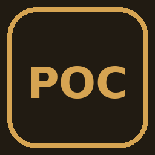

# Pocket Factory 3.2.0



[](https://github.com/YoungLionOrganization/LMGOfficalGames/actions/workflows/pocket_factory.yml)
[](LICENSE)
[](https://github.com/YoungLionOrganization/LeoMiniGames/releases)

[All games](../../README.md#games) · [Get LeoMiniGames](https://github.com/YoungLionOrganization/LeoMiniGames/releases)

Deepened factory management with six production lines, inventories, managers, research, contracts, storage upgrades, offline income and Crown prestige progression.

This is the GPL-licensed 3.2.0 edition from Volume 4. Its original license notice is in [LICENSE-NOTICE.txt](LICENSE-NOTICE.txt).

## Build from the repository root

With Python 3.11 or newer and Qt 6's `rcc` installed, run

```sh
python tools/build_game.py pocket_factory --rcc /path/to/rcc
```

If `rcc` is on `PATH`, omit `--rcc`. The build writes `pocket_factory-3.2.0.rcc`
and its SHA-256 checksum to this game's `dist/` directory. Open the package in
LeoMiniGames 0.6.2 or newer.

The [GitHub Actions workflow](../../.github/workflows/pocket_factory.yml) builds the
RCC and attaches it to successful workflow runs.

## License

[GPL-3.0-or-later](LICENSE).
