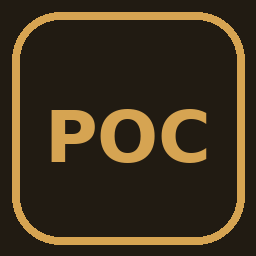

# Pocket Factory Community 4.0.0



[](https://github.com/YoungLionOrganization/LMGOfficalGames/actions/workflows/pocket_factory_community.yml)
[](LICENSE)
[](https://github.com/YoungLionOrganization/LeoMiniGames/releases)

[All games](../../README.md#games) · [Get LeoMiniGames](https://github.com/YoungLionOrganization/LeoMiniGames/releases)

Deepened factory management with six production lines, inventories, managers, research, contracts, storage upgrades, offline income and Crown prestige progression.

Follow six production lines from the Ore Drill to the Export Dock. Buy patents
and complete district projects to build a factory city. In Settings and help,
choose Off, Low, or Full for the SVG factory view.

Community uses a separate game ID from the store edition. To copy a GPL 3.2
autosave, close LeoMiniGames, then follow the [desktop save transfer guide](../../docs/pocket-factory-save-transfer.md).

## Build from the repository root

With Python 3.11 or newer and Qt 6's `rcc` installed, run

```sh
python tools/build_game.py pocket_factory_community --rcc /path/to/rcc
```

If `rcc` is on `PATH`, omit `--rcc`. The build writes `pocket_factory_community-4.0.0.rcc`
and its SHA-256 checksum to this game's `dist/` directory. Open the package in
LeoMiniGames 0.7.3 or newer.

The [GitHub Actions workflow](../../.github/workflows/pocket_factory_community.yml) builds the
RCC and attaches it to successful workflow runs.

## License

[GPL-3.0-or-later](LICENSE).
